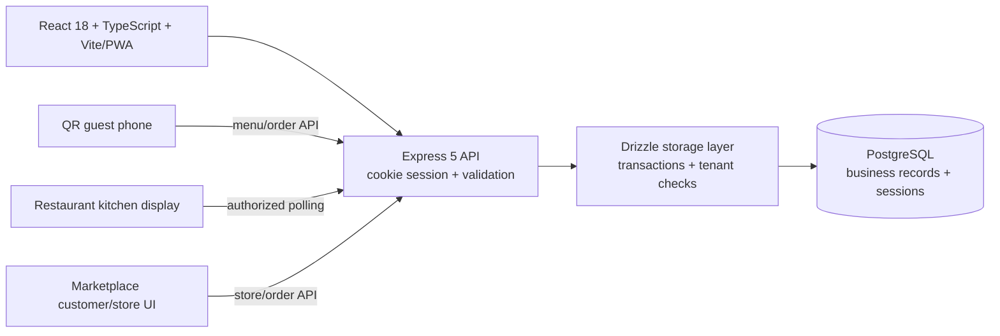

# Amar Dokan POS — Engineering Readiness Report

**Assessment date:** 2026-10-18  
**Scope:** Source review and the changes in this working tree. This is not a security certification or a production rollout.

## Executive summary

This repository is not the browser-only IndexedDB application described in the earlier assessment. The checked-in application already has a React/Vite client, an Express API, Drizzle data access, PostgreSQL persistence, server sessions, and server endpoints for guest orders. It is a server-first web application; it does **not** currently provide offline transaction synchronization.

This pass hardened financial validation, stock ownership, authentication, API error handling, and restaurant order delivery; fixed the store profile data returned to the marketplace; and made inventory easier to search and operate. A development database migration was applied additively. TypeScript, the unit tests, and the production web build pass.

The application is **not production-ready**. No database-backed integration or adversarial tenant tests were available in this pass. Restaurant payment settlement/refunds, a genuine offline write/sync protocol, complete tenant/RBAC coverage, tested backup restoration, and Android APK packaging remain incomplete. Do not use this report as evidence that those criteria passed.

## Architecture observed

Restaurant kitchen and store-order screens poll the server every five seconds; guest order status polls every eight seconds. This is a real shared-server path, not a local IndexedDB sync queue or a WebSocket. Polling is not instant delivery and depends on the API and database being reachable.

## Issue register

| Severity | Finding and root cause | Business impact | Change made | Regression evidence |
|---|---|---|---|---|
| High | Checkout accepted unsafe money values and did not consistently separate cash received, applied payment, due, and change. | Incorrect receipts, dues, and profit records. | Added a shared integer-paisa calculation service with bounded inputs, a defined rounding rule, VAT/discount validation, payment-method rules, and separate cash/change fields. Server recalculates new sales; the POS uses the same calculator. | `tests/finance.test.ts`: zero totals, fractional quantities, rounding, discount/VAT, partial payment, cash overpayment, invalid inputs. |
| High | Stock updates and product access needed stronger store ownership, stock validation, and retry behavior. | Cross-store changes, negative inventory, overselling, or duplicate deductions. | Product writes and sales use store-scoped server transactions, row locks, ownership checks, stock checks, and idempotent sale IDs. Marketplace orders use server product prices and transactional stock deduction/restocking. | Type-check/build and finance/credential unit tests pass. **Concurrent database integration tests were not run.** |
| High | PIN verification relied on legacy unsalted SHA-256 and lockout had a documented administrator exception. | Guessable credentials and weaker brute-force protection. | Added salted scrypt PIN verifiers, upgrade-on-success for legacy hashes, temporary lockout, per-IP rate limits, session regeneration, production secret requirements, secure production cookies, and explicit platform-admin ID allowlisting. Removed public default credentials from docs and seeding. | `tests/credentials.test.ts`: salted hashes, verification, legacy upgrade format, malformed/short PIN rejection. **Login/session integration tests were not run.** |
| High | Serving a restaurant order created a paid cash sale without evidence of payment. | False cash, revenue, and profit records. | Removed sale creation from the “served” action. Serving now changes fulfillment only. | Code path checked and TypeScript/build pass. **Authorized payment settlement is still not implemented.** |
| High | Public QR orders needed authoritative prices and stable retries; the kitchen needed cross-device refresh. | Tampered totals, duplicate orders, or orders invisible to kitchen staff until reload. | Guest order prices/totals are recalculated by the server, request IDs are idempotent, the kitchen polls the shared API, and failed refreshes preserve the last visible orders with an error/retry state. | TypeScript/build pass. **No multi-device or database-backed order lifecycle test was run.** |
| High | Sensitive API paths needed stronger ownership and staff-permission enforcement. | Staff or another store could perform actions outside intended scope. | Added server permission checks to the affected product, sales, expense, restaurant, and marketplace routes; scoped expense/table/product/order mutations to the active store; staff responses no longer inherit platform-admin UI status from their owner. | Static type-check and build pass. **A complete route-by-route adversarial tenant/permission audit remains open.** |
| Medium | Store marketplace data omitted profile fields, and the profile update allowlist used the wrong spelling for `upozila`. | Owner details and profile image were missing or did not save. | Corrected the server allowlist and included public store image/location/contact metadata and product count in directory responses. Profile save failures now remain visible without replacing the profile screen. | TypeScript/build pass. Signed-in profile UI was not browser-verified. |
| Medium | Inventory lacked convenient search, low-stock visibility, and clear save/load failures; API requests could fail without actionable feedback. | Slower stock work and uncertain outcomes during connection failures. | Added inventory search and empty/loading/retry/error states, save protection, safer IDs, request timeouts, clearer connection errors, order polling states, and a truthful online/offline indicator. Error-boundary reload no longer clears local storage. | TypeScript/build pass. |
| Medium | Existing populated databases could be endangered by an unreviewed schema push. | Loss of the session table/data during a schema update. | Added an idempotent additive SQL migration and documented that Drizzle push must not be accepted if it proposes deleting existing tables. Applied the additive migration to the development database only. | Development schema verified for `sales.cash_received`, `sales.change_amount`, `inventory_logs.actor_id`, and `users.locked_until`. Production was not touched. |

## Implementation status

### Implemented in this pass

- New POS sales are recalculated server-side; invalid/non-finite or negative financial inputs are rejected.
- New cash sales store cash received, amount applied, due, and change distinctly. Historical sales are not rewritten; new nullable fields remain null for legacy records.
- Product/sale/expense/table/order operations touched in this pass are store-scoped and use server-side authorization checks.
- Staff discount defaults to 10%; owner discount defaults to 100%. Configure `STAFF_MAX_DISCOUNT_PERCENT` and `OWNER_MAX_DISCOUNT_PERCENT` in the server environment.
- Password/PIN hashing and session handling were strengthened; a public/default owner is not seeded automatically.
- Guest ordering uses the backend, authoritative menu prices, idempotency keys, and status polling. Serving does not mark payment as received.
- Marketplace order updates and cancellation use store scope and transactional stock handling.
- Inventory search, low-stock count, error/loading/empty states, duplicate-save prevention, and profile error feedback were improved.
- CI workflows now run unit tests in addition to type-check/build. **The GitHub workflows themselves were not executed on GitHub in this session.**

### Still incomplete or unverified

- Offline POS writes and reconciliation: **not implemented**. Core business records require the server/database. A failed request is shown as a failure; there is no local outbox or claim of cloud sync.
- Restaurant settlement, partial payments, refunds, voids, and payment audit trail: **not implemented**. Fulfillment status is separate, but there is no payment screen/API yet.
- Full multi-tenant foreign-key constraints and adversarial tests across every entity: **not verified**.
- Full RBAC audit, subscription entitlements at a trusted backend, and account recovery: **not verified**.
- Automated database backups, validated export/import, and restoration drill: **not implemented/tested**.
- Automated migration/rollback test against a disposable database: **not run**.
- Distributed rate limiting: the current rate limiter is process-local and is not sufficient for horizontally scaled production.
- Real-time push: no WebSocket/SSE delivery was verified; the app currently polls.
- Android packaging: this repository has no Android/Gradle/Capacitor project or APK release workflow. The checked-in GitHub workflows build the web app and deploy to Render, not an APK.

## Database migration and recovery

`migrations/0001_financial_stock_fields.sql` is additive and idempotent. It adds nullable sale cash/change fields, an inventory actor field, the owner lockout timestamp, and store-scoped indexes. It preserves historical sale values.

The migration has been applied and verified in the **development** database. It has **not** been applied to production.

For a populated deployment:

1. Take a PostgreSQL backup and verify that the backup file is readable before changing the schema.
2. Review and apply the SQL migration to the intended database. Do not run `npm run db:push` if it proposes dropping or recreating existing tables (in particular the `connect-pg-simple` session table).
3. Verify the application and schema before allowing writes.
4. If the migration fails, stop writes and restore the backup to a separate recovery database first. Do not overwrite the original database without reviewing the recovery plan.

This repo does not yet provide a tested in-app restore flow or an automated restore drill. Keep provider/database backups configured independently.

## Build, tests, and checks executed

| Check | Result |
|---|---|
| `npm ls --depth=0` | Passed; installed top-level dependency tree resolved. |
| `npx tsc --noEmit --pretty false` | Passed. |
| `npm test` | Passed: 11 tests, 0 failures (8 financial calculation cases and 3 credential cases). |
| `npm run build` | Passed; Vite production build and PWA service-worker generation completed. |
| `git diff --check` | Passed. |
| Development migration columns | Passed; all four expected added columns were present. |
| API/auth/database integration and concurrency tests | Not run; no isolated disposable test database was configured. |
| Signed-in browser workflow | Not verified; the preview browser has no authenticated session. |
| Production deployment or APK release | Not run. |

## Deployment and environment

- Existing deployment path is the checked-in Render configuration and GitHub deploy workflow; follow `README.md` for the web deployment.
- Production requires a strong `SESSION_SECRET` of at least 32 characters and a correctly configured PostgreSQL `DATABASE_URL`.
- Configure `PLATFORM_ADMIN_USER_IDS` only with the intended owner-account IDs; configure rate limits and discount ceilings as needed.
- Bootstrap an owner using the documented one-time `npm run seed:owner` flow or normal owner registration. Do not put a real PIN or secret in source control.
- No Dockerfile, Android wrapper, signing keystore, or APK release job is present in this repository.

## Remaining production blockers (priority order)

1. Decide the offline business rule, then implement an idempotent offline outbox with conflict handling and visible reconciliation; do not sync sales blindly.
2. Implement authorized restaurant invoice/payment settlement, partial payment/refund/void operations, and audit records.
3. Complete tenant/RBAC integration tests, including simultaneous sales, duplicate requests, and cross-store IDs.
4. Implement and test encrypted/validated backup export and restoration against a separate database.
5. Decide whether this repository should own Android packaging. If yes, add a native wrapper and GitHub Actions release workflow; signed updateable releases require a release keystore configured through GitHub Secrets.
6. Test production migrations and deployment in a staging environment before applying them to a live shop database.
